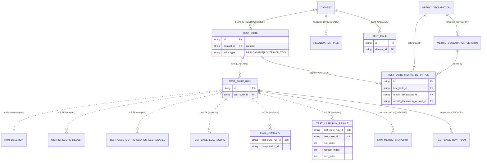

# Entity-Relationship Model

> **Status**: Current (reflects meta V1.38, analytics V1.22)
> **Last Updated**: 2026-11-12

Conceptual data model of the Evaluation Framework: which entities exist, where they live, and how they
relate. Column-level detail (types, indexes, JSONB shapes, migration history) lives in
[database-schema.md](../database-schema.md) and is not repeated here.

---

## 1. Two databases

| DB | Role | Entities |
|----|------|----------|
| **Meta** | Authoring + run control; transactional, mutable, FK-enforced | Dataset, TestCase, RevalidationTask, TestSuite, MetricDeclaration (+ versions), TestSuiteMetricDefinition, TestSuiteRun, TestCaseRunInput, RunMetricSnapshot |
| **Analytics** | Run outputs; append-only, high volume | TestCaseRunResult, EvalSummary, TestCaseEvalScore, TestCaseMetricScoresAggregated, MetricScoreResult, RunDeletion |

- Both are PostgreSQL with separate Flyway histories, `DSLContext`s and transaction managers — see
  [dual-datasource](../patterns/dual-datasource.md).
- **No cross-DB foreign keys.** Analytics rows reference meta entities (`test_suite_run_id`,
  `test_suite_id`, `test_case_id`) by ID only ("soft FK"); integrity on delete is handled by tombstones (§4).
- `run_metric_snapshots` lives in meta; the analytics table of the same name is frozen (migration history in
  [database-schema](../database-schema.md)).
- File attachments are **not** stored in either DB: they live in DIAL Core file storage and are referenced
  from JSONB data as `@ef/suites/{suiteId}/…` / `@ef/datasets/{datasetId}/…` paths
  ([dial-file-storage](../patterns/dial-file-storage.md)). The old `blobs` table was dropped (meta V1.14).

## 2. Relationships

Solid lines are physical FKs in meta (delete rule in parentheses); dotted lines are ID-only references into
analytics. `TestCaseRunInput.test_case_id` and `RunMetricSnapshot.tsmd_id`/`metric_declaration*_id` are
deliberately loose (no FK) — they are snapshots and must survive later edits/deletes.

## 3. Entity catalog

**Dataset** — owner of the test-case schema (`test_case_schema`, fields carry stable `id`s so renames are
not delete+create) and of its test cases. Name globally unique (case-insensitive, `uq_datasets_name` on
`LOWER(name)`). `visibility` is `PUBLIC` (listed, shareable by many suites) or
`PRIVATE` (hidden, bound to at most one suite, enforced by trigger). Optimistic `version`. See
[dataset-entity](../patterns/dataset-entity.md).

**TestCase** — one row of input data in a dataset; name unique per dataset (case-insensitive). Single-turn
cases use `data`; multi-turn cases carry an ordered `multi_turn_data` array (non-null ⇒ multi-turn,
[multi-turn-test-cases](../patterns/multi-turn-test-cases.md)). `is_valid` + `validation_warnings` reflect
validation against the dataset schema.

**RevalidationTask** — async job record for re-validating a dataset's test cases after a schema change
(status, progress counters, coerced-cell count). See [schema-coercers](../patterns/schema-coercers.md).

**TestSuite** — what to call and how. Binds to at most one Dataset (`dataset_id` nullable; unbound suites
cannot run). `suite_type` discriminates the target: `DEPLOYMENT` (`deployment_ref`), `ROUTE` (`routes_ref`,
global DIAL Core route) or `MCP_TOOL` (`mcp_deployment_ref` + `tool_ref`); internally modelled as the
sealed `SuiteTarget`/`SuiteDefinition` ([suite-target](../patterns/suite-target.md)). HTTP suites hold a
request template, response columns and an `additional_requests` chain
([multi-request-suites](../patterns/multi-request-suites.md)). Scoring config: `overall_score`,
`test_case_overall_score`, `overall_score_threshold`, `metric_score_aggregation`
([overall-score-definition](../patterns/overall-score-definition.md)). `test_case_filter` (Query DSL
filter) selects runnable cases. `is_valid` covers config only
([suite-validity-and-run-guards](../patterns/suite-validity-and-run-guards.md)). Optimistic `version`.

**MetricDeclaration / MetricDeclarationVersion** — metric catalog synced from configured metric providers
(`GET /metrics`); identity is `(provider_id, name)`. Each schema or description change appends a version
(`schema_version`, config/input/output JSON schemas); the declaration row denormalizes the latest
`display_name`/`description`. Sync upserts; it never removes declarations.

**TestSuiteMetricDefinition (TSMD)** — application of a metric to a suite: unique name per suite,
`config_bindings`/`input_bindings`, pinned `metric_declaration_version_id` (resolved server-side to latest
at write time), `is_enabled`, soft `is_valid` + warnings, optional JSONata `condition` evaluated per result
row (see AGENTS.md "Conditional metric execution").

**TestSuiteRun** — one execution of a suite. `status`: `PENDING → RUNNING → COMPLETED | FAILED`; cancelling a
`RUNNING` run goes via `CANCELLING → CANCELLED` (or `FAILED`), cancelling a `PENDING` run is a CAS straight to
`CANCELLED`; `PENDING → FAILED` on snapshot / route-trigger failure or startup reconciliation
(`PENDING`/`RUNNING`/`CANCELLING` count as active for concurrency limits).
`run_config` (concurrency, retries, `numberOfRuns`, …) and `suite_snapshot` (execution-relevant suite
config frozen at snapshot time). Run name unique per suite.

**TestCaseRunInput** — frozen copy of each runnable test case (`test_case_data`/`multi_turn_data`), keyed
`(run_id, position)`; the executor's source of truth for the run. Purged after a retention window
(`test-suite-run.run-inputs.retention-days`).

**RunMetricSnapshot** (meta) — per `(computation_id, tsmd_id)`: the TSMD name, declaration version,
bindings and output schema actually used by one metric computation.

**TestCaseRunResult** (analytics) — one row per `(run, test case, run_index, request_index, turn_index)`:
response, extracted response columns, status/error, timings, retries. Idempotent writes on that key.

**EvalSummary** (`test_case_eval_summaries`, analytics) — metric-enriched copy of each result row per
`computation_id` (`metric_values`, `metric_infos`). Written for every result row even with zero metrics —
the single read surface ([eval-summaries-read-surface](../patterns/eval-summaries-read-surface.md)).

**TestCaseEvalScore** (analytics) — per `(run, test case, computation)` overall `score`/`passed`, computed
once per test case after the last Phase 2 flush.

**TestCaseMetricScoresAggregated** (analytics) — per `(run, test case, computation)` avg/min/max/count of
each metric, collapsed across run/request/turn indices; feeds statistics, overall scores and run comparison.

**MetricScoreResult** (`metric_score_result`, analytics) — run-level statistics (AVG/P10/P90/MIN/MAX,
`overall`) per `(run, computation, statistic, metric field)`, written in Phase 3.

**RunDeletion** (`run_deletions`, analytics) — one tombstone per deleted run
([run-deletion-tombstone](../patterns/run-deletion-tombstone.md)).

## 4. Key design rules

- **Snapshot at run start** — the run copies runnable test cases into `test_case_run_inputs` and the suite
  config into `suite_snapshot` in one REPEATABLE READ transaction (retried on `40001`); later edits never affect a running
  or finished run. [suite-run-snapshot](../patterns/suite-run-snapshot.md)
- **Computation versioning, no `is_latest`** — every metric (re)computation gets a new `computation_id`;
  "latest" is resolved at query time from eval summaries.
  [computation-versioning](../patterns/computation-versioning.md)
- **Append-only analytics + tombstones** — analytics rows are never updated or deleted; run deletion
  appends to `run_deletions` before the meta delete, and every run-scoped analytics read filters it out.
- **JSONB for flexible shapes** — per-dataset test-case data, request templates, response columns, metric
  bindings/values and schemas are JSONB; fixed columns are extracted only where queries need them.
  Queried through the Query DSL ([jsonb-numeric-filtering](../patterns/jsonb-numeric-filtering.md),
  [test-cases-query-entity](../patterns/test-cases-query-entity.md)).
- **UUIDs as `VARCHAR(36)`, timestamps as epoch-ms `BIGINT`**; one shared `created_at`/`updated_at` per
  transaction ([transaction-timestamp](../patterns/transaction-timestamp.md)).

## 5. Decisions

- PostgreSQL for both meta and analytics (JDBC + jOOQ, no JPA).
- Global scope: no workspace/tenant dimension.
- Metric declarations are versioned; a TSMD pins the version it was configured against.
- Metric declaration identity is `(provider_id, name)`; sync never deletes missing declarations.
- Test-case name is unique per dataset; run comparison matches rows on `lower(test_case_name)` +
  run/request/turn index, not on test-case id.
- Recalculating metrics appends a new computation rather than overwriting results.
