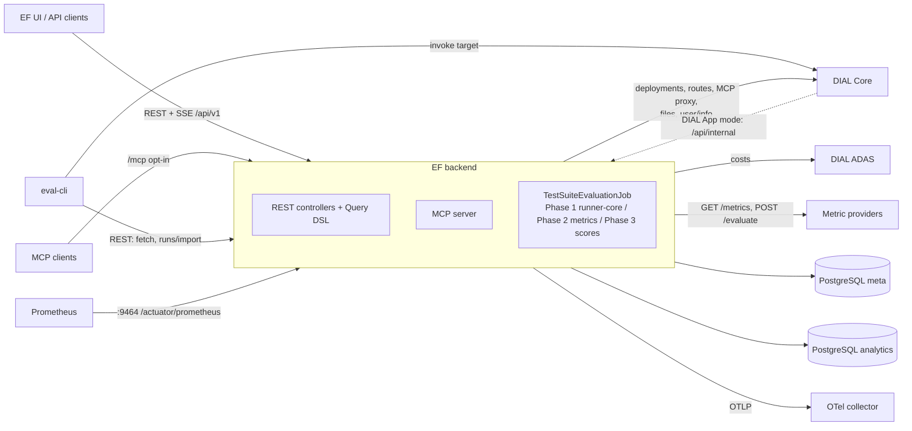

# Infrastructure Architecture

> **Status**: Current
> **Last Updated**: 2026-11-12

Runtime topology of the Evaluation Framework (EF) backend: components, external dependencies, data flows,
security and deployment. Data model: [entity-relationship-model.md](entity-relationship-model.md).
Configuration: [configuration.md](../configuration.md). Package map: [key-packages.md](../key-packages.md).

---

## 1. Components

| Component | Role |
|-----------|------|
| **EF backend** (root module, Spring Boot) | REST API `/api/v1/**`; Query DSL (`/api/v1/queries`); inbound MCP server at `/mcp` (opt-in, [mcp-server](../patterns/mcp-server.md)); **in-process** run execution — no separate workers or job scheduler |
| **`evaluation-runner-core`** (library) | DB-free Phase 1 engine (request templating, invocation, response extraction, retries), contributed by autoconfiguration; `RunExecutorFactory` builds per-run thread-per-task worker executors (virtual threads by default). [evaluation-runner-core-module](../patterns/evaluation-runner-core-module.md) |
| **`eval-cli`** (standalone bootJar) | Picocli CLI: clone/fetch suites from an EF instance, execute them against a target deployment with `evaluation-runner-core`, import results back via `runs/import`. Not deployed with the backend. See [eval-cli/README.md](../../eval-cli/README.md) |
| **DIAL Core** | Target invocation (deployments, global routes, MCP proxy for MCP-tool suites), deployment listing, file storage (`@ef` bucket), API-key introspection (`GET /v1/user/info`), DIAL App route proxy |
| **DIAL ADAS** | Usage/cost queries (`/v1/queries/execute` and raw-SQL `/v1/queries/execute-sql`) for run and deployment costs and the opt-in `total_cost` Query DSL extension |
| **Metric providers** | External services (`dial`, optional `extra`): `GET /metrics` feeds declaration sync (on startup + optional cron, only when `metric-providers.sync.enabled`, default `false`); `POST /evaluate` scores each result row during the run's metric phase |
| **PostgreSQL meta + analytics** | Two databases, each with its own Flyway history (meta runs after analytics). [dual-datasource](../patterns/dual-datasource.md) |
| **Observability backends** | OTLP collector (traces/logs/metrics), Prometheus scrape of actuator, Grafana/Tempo for trace links |

## 2. Data flows

### Suite authoring
Datasets, test cases (incl. CSV/ZIP import/export, [zip-archive-round-trip](../patterns/zip-archive-round-trip.md)),
suites, TSMDs → meta DB. Attachments upload to DIAL Core file storage and are referenced by path
([dial-file-storage](../patterns/dial-file-storage.md)). Schema changes trigger async revalidation.
Try-out sends one request to the target synchronously. Metric declarations come only from provider sync.

### Run lifecycle
1. **Create** — `POST /api/v1/test-suites/{id}/runs` runs the ordered guards and concurrency limits, inserts
   a `PENDING` run, returns 202 ([suite-validity-and-run-guards](../patterns/suite-validity-and-run-guards.md)).
2. **Dispatch** — `TestSuiteEvaluationJob` runs on the job executor, registered in `ActiveRunRegistry`.
   The caller's credential is propagated across threads ([token-propagation](../patterns/token-propagation.md)).
3. **Snapshot** — test cases → `test_case_run_inputs`, suite config → `suite_snapshot`; status `RUNNING`
   ([suite-run-snapshot](../patterns/suite-run-snapshot.md)).
4. **Phase 1, execute** — per-run worker executor invokes the target per test case × repetition × request ×
   turn; results batched into analytics `test_case_run_results`.
5. **Phase 2, metrics** — per result row, enabled TSMDs (after `condition`) call provider `/evaluate`;
   writes eval summaries + per-test-case scores/aggregates (analytics) and `run_metric_snapshots` (meta).
6. **Phase 3, scores** — run-level statistics and `overall` → `metric_score_result`.
7. **Status** — terminal `COMPLETED`/`FAILED`; clients follow `GET /api/v1/test-suite-runs/status-stream`
   (SSE) or poll.

CSV result import (`runs/import`, used by eval-cli) skips Phase 1 and runs Phases 2–3.

**Cancellation** — `POST /api/v1/test-suite-runs/{id}/cancel` moves a `PENDING` run straight to
`CANCELLED` (CAS); a `RUNNING` run gets `CANCELLING`, its worker executor is torn down and the job finalizes
`CANCELLED` via guarded status writes ([run-cancellation](../patterns/run-cancellation.md)).

**Deletion** — deleting a run (or a suite) appends a `run_deletions` tombstone in analytics *before* the
meta delete; analytics reads exclude tombstoned runs ([run-deletion-tombstone](../patterns/run-deletion-tombstone.md)).

### DIAL App mode
Opt-in (`dial-app-proxy.enabled`) for long runs that would outlive the user's JWT. On dispatch,
`DialRouteTriggerClient` calls DIAL Core's route for the EF app deployment once with the JWT; Core mints a
per-request key and proxies to `POST /api/internal/runs/{runId}/execute`, authenticated as an API key.
`EvalExecuteInternalController` dispatches the job and holds an SSE stream with heartbeats
(`heartbeat-interval-ms`, default 30 s) — the key stays valid while the stream is open; disconnect cancels
the run. [dial-app-mode](../patterns/dial-app-mode.md)

## 3. Security

- **OIDC/JWT, multi-issuer** (`config.rest.security.mode=oidc`, default): per-issuer decoders and role
  claims; caller must hold an allowed role (`config.rest.security.default.allowedRoles`, default `admin`).
  `/api/v1/**`, `/api/internal/**` and `/mcp` require authentication; `/api/v1/health/**` and (by default)
  Swagger are public; everything else is denied.
- **API key** (opt-in, `API_KEY_ENABLED`): `Api-Key` header introspected against DIAL Core
  `/v1/user/info` (cached), roles mapped via config.
- **`mode=none`** disables security for local development/tests.
- No per-user or per-resource authorization: any authorized caller sees and edits every entity.
- Outbound calls to DIAL Core use the caller's credential (JWT, API key or DIAL App per-request key);
  `dial.api-key` is the service key for EF-owned calls (e.g. file storage).

## 4. Deployment

- **Single Docker image** (multi-stage: Gradle 9.9.1/JDK 25 build → Amazon Corretto 25 Alpine runtime,
  non-root `appuser`), entrypoint passes `JAVA_OPTS`/`DEBUG_OPTS`; optional system CA import.
- **Ports**: `8080` application, `9464` management (actuator `health`, `info`, `prometheus`, `metrics`).
- **Probes**: `/api/v1/health/live` and `/api/v1/health/ready` on 8080 are static (no dependency checks);
  the actuator readiness group on 9464 checks `dialFileStorage`, `database`, `analyticsDatabase`.
  Docker `HEALTHCHECK` hits `/api/v1/health`.
- **Datasources**: per DB `datasource.{meta|analytics}.auth.type` = `basic` (user/password) or `azure`
  (short-lived Azure AD tokens).
- **Concurrency limits** (defaults): 20 active runs globally, 5 per suite; per-run concurrency default 1,
  max 50; metric evaluation 5 concurrent calls per provider.
- **Threads**: virtual threads by default; `VIRTUAL_THREADS_ENABLED=false` switches Boot and run
  executors to platform threads for profiling.
- Runs execute inside the app process. On startup `TestSuiteRunReconciliation` marks every
  `PENDING`/`RUNNING` run `FAILED` (`ORPHANED_RUN`) and every `CANCELLING` run `CANCELLED` — it does not
  distinguish instances, so restarting one replica also fails runs owned by the others. Multi-replica
  deployments are not supported for run execution today.

## 5. Observability

- OpenTelemetry SDK **disabled by default** (`OTEL_SDK_DISABLED=true`); when enabled exports traces, logs
  and metrics over OTLP. Trace model: [evaluation-tracing](../patterns/evaluation-tracing.md).
- Prometheus metrics at `:9464/actuator/prometheus`.
- `X-Correlation-Id` propagated and written to the Tomcat access log; optional Grafana/Tempo deep links
  (`app.grafana.*`).
- Optional method trace logging via `@LogExecution` (`CUSTOMIZABLE_TRACE_INTERCEPTOR_ENABLED`); log levels
  reloadable from `/app/log-config/logging.levels.json`.

## 6. Not in this architecture

No Kubernetes Jobs or external workers, no message broker, no object/blob store of EF's own (files live
in DIAL Core), no ClickHouse — PostgreSQL only.
